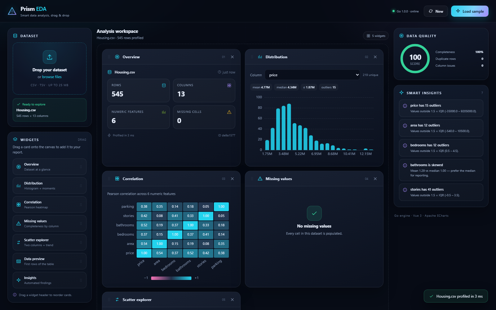
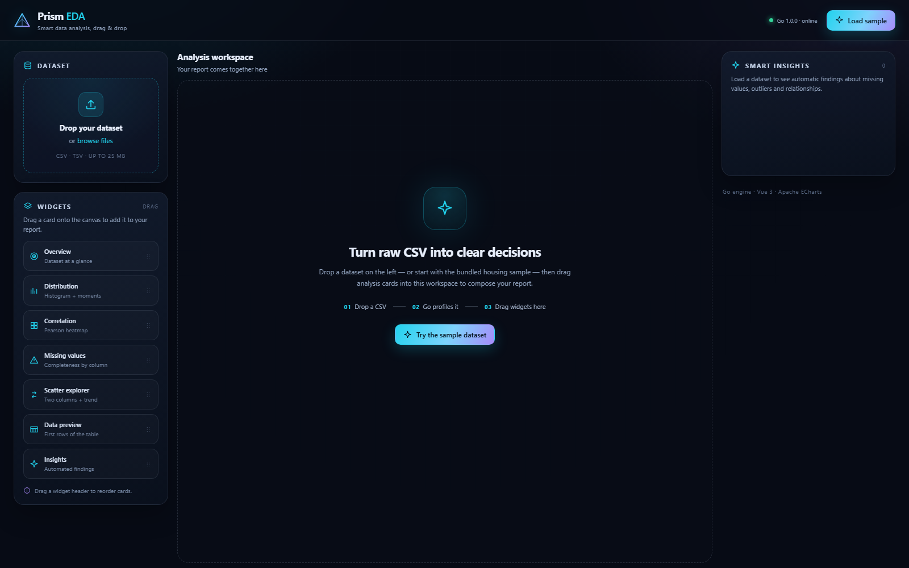
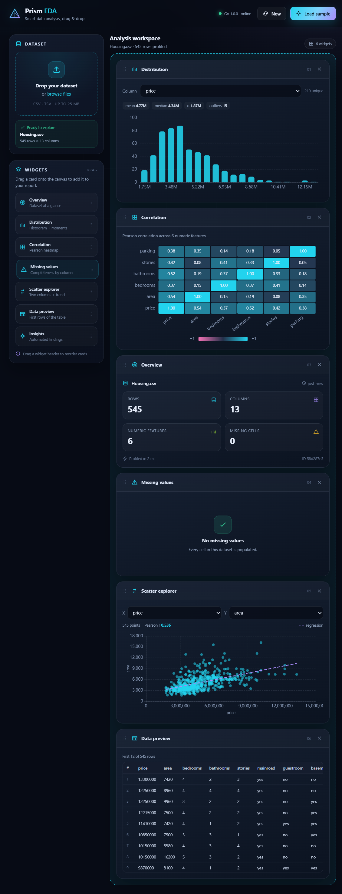
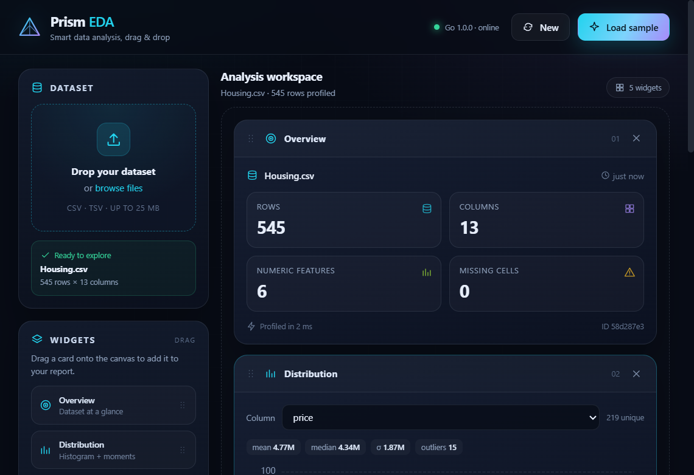
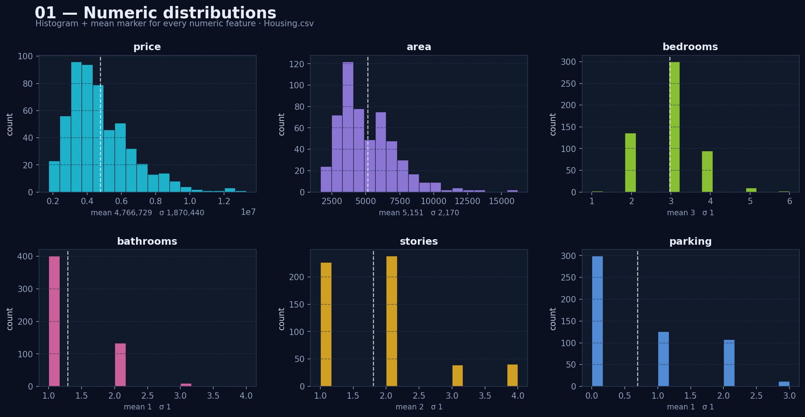
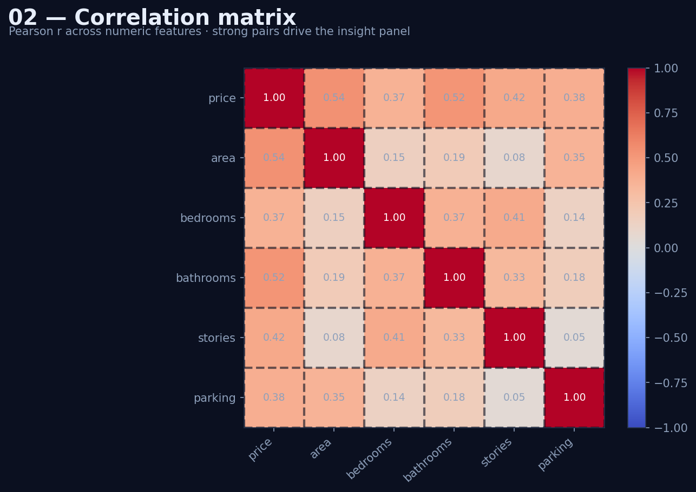
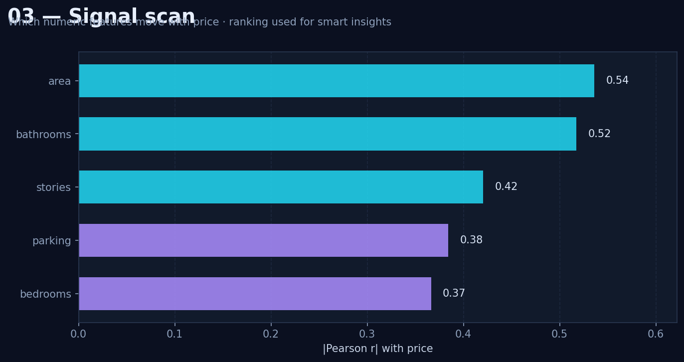
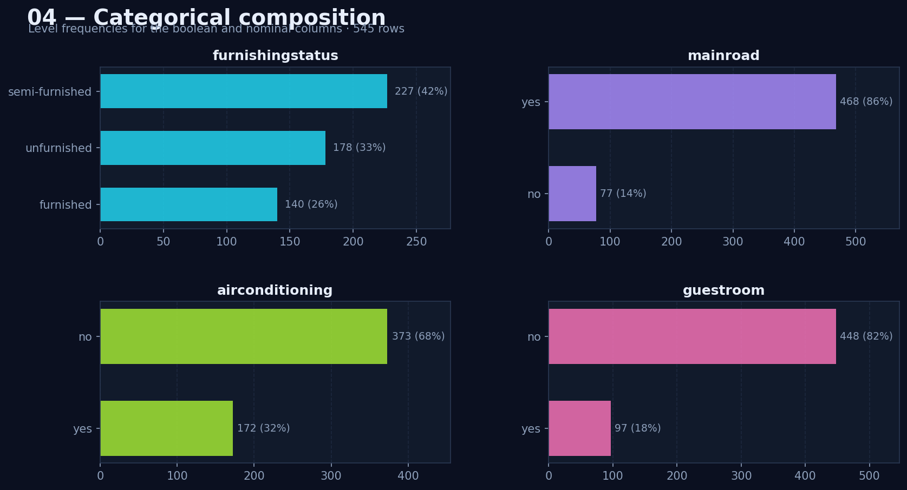

<div align="center">



# Prism — Smart EDA in the browser

**Drop a CSV. Let Go profile it. Drag the charts you want into your own report.**

`Go 1.26` · `Vue 3 + TypeScript` · `Apache ECharts` · `Gin` · `zero Python at runtime`

</div>

---

Prism is a web-based **Exploratory Data Analysis** workbench. The heavy lifting is a clean, dependency-light Go analysis engine; the interface is a Vue 3 dashboard where you drag a dataset in and then drag analysis widgets around to compose a report. It is the evolution of a small housing-price API: the placeholder linear model is gone, replaced with a real profiling pipeline (type inference, descriptive statistics, correlations, data-quality scoring and automated insights).

**Portfolio angle:** the backend is intentionally layered (`cmd → api → service → eda/store`), fully typed at the HTTP boundary, concurrency-safe, and tested. The frontend is not a boilerplate table — it is a designed analytics product with native HTML5 drag-and-drop, tree-shaken charts, responsive layout and no UI drag library.

## Table of contents

- [What it does](#what-it-does)
- [Quick start](#quick-start)
- [Screenshots](#screenshots)
- [How the Go analysis engine works](#how-the-go-analysis-engine-works)
- [HTTP API](#http-api)
- [Frontend architecture](#frontend-architecture)
- [Static analysis figures (matplotlib)](#static-analysis-figures-matplotlib)
- [Project layout](#project-layout)
- [Tests & verification](#tests--verification)
- [Configuration](#configuration)
- [Design decisions & limits](#design-decisions--limits)

## What it does

| Capability | Details |
| --- | --- |
| **Drop a dataset** | Drag & drop or browse `.csv`, `.tsv`, `.txt`; delimiter sniffing, BOM removal, ragged-row padding, duplicate-header repair, 25 MB / 200k row guardrails. |
| **Type inference** | Samples up to 2,000 values and classifies columns as numeric, boolean or categorical at a 90% confidence threshold. |
| **Numeric profiling** | Min, max, mean, median, sample standard deviation, sum, P25/P75, 1.5×IQR outlier count, and a Freedman–Diaconis histogram. |
| **Categorical profiling** | Top 10 values with percentages, distinct count, Shannon entropy. |
| **Relationship scan** | Pearson correlation matrix over up to 12 numeric features, top pairs ranked by \|r\|. |
| **Smart insights** | Strong correlations, high missingness, constant columns, outliers, skew, high cardinality and duplicate rows, sorted by severity. |
| **Quality score** | 0–100 score from completeness minus duplicate, ragged-row and constant-column penalties. |
| **Compose a report** | Drag 7 widget types (overview, distribution, correlation heatmap, missing values, scatter explorer, data preview, insights) onto the canvas; drag headers to reorder. |
| **Deep data** | Scatter widget fetches up to 1,500 real point pairs and draws a least-squares trend line in the browser. |

## Quick start

Prerequisites: **Go 1.25+** and **Node 20+**. The repository ships a prebuilt SPA in `web/dist`, so the backend alone is enough to run it.

```bash
# 1. Start the API + bundled frontend (serves on :8123)
go run ./cmd/api

# 2. Open the live demo in your browser
#    http://localhost:8123/?sample=1   <- auto-loads the 545-row housing dataset
#    http://localhost:8123/            <- empty workspace, drop your own CSV
```

To work on the frontend with hot reload:

```bash
go run ./cmd/api          # terminal 1: API on :8123
cd web && npm install && npm run dev   # terminal 2: Vite on :5173, proxies /api
```

To rebuild the SPA for Go to serve:

```bash
cd web && npm run build && cd ..
go run ./cmd/api
```

## Screenshots

**Analysis workspace** — five widgets generated automatically from the sample dataset, with the smart-insight rail on the right:


**Empty state** — the drop zone, widget palette and onboarding steps appear before any dataset is loaded:



**Composed report** — the same dataset after dragging the *Data preview* widget onto the canvas and reordering cards:



**Compact viewport** — the layout collapses the insight rail below 1300 px and keeps the canvas usable:



## How the Go analysis engine works

```text
POST /api/datasets (multipart CSV)
        │
        ▼
eda.Parse ─────────► Table { Headers, Rows, SizeBytes, InvalidRows }
        │  sniff delimiter · strip BOM · pad ragged rows · de-duplicate names
        ▼
inferKind ─────────► numeric | boolean | categorical   (≥90% of sampled values)
        │
        ▼
BuildProfile ──────► per-column stats + histogram
        │            ├─ Pearson matrix (≤12 numeric columns)
        │            ├─ duplicate-row & completeness scoring
        │            └─ severity-ranked insights (max 12)
        ▼
store.Put(id, table, profile) ──► JSON profile to Vue
```

**Why these choices**

- **Pure standard library for analysis.** `encoding/csv`, `math`, `sort` and `strconv` do the work. No Python, no dataframe dependency, no model artifact to ship. The service starts in milliseconds and can be deployed as one Go binary plus a `dist/` folder.
- **Freedman–Diaconis bins**, clamped to 5–20 bins with a Sturges fallback, keep histograms readable for both 50-row and 200k-row datasets.
- **Pearson pairs skip missing values**; a pair needs at least 3 overlapping observations and non-zero variance. The matrix is symmetric and diagnostics are capped so a wide dataset cannot make the UI unreadable.
- **Quality score** = `100 × completeness − 20 × duplicateRate − 10 × raggedRate − 10 × constantColumnRate`, clamped to `[0, 100]`.
- **One shared `Profile` DTO** is returned by upload, sample and profile endpoints, so the frontend never re-implements statistics.
- **Concurrency-safe in-memory store** (`sync.RWMutex`) keeps parsed tables available for preview and scatter queries without touching disk again.

## HTTP API

| Method | Path | Purpose |
| --- | --- | --- |
| `GET` | `/api/health` | Status, version, Go version, uptime, dataset count |
| `POST` | `/api/datasets` | Upload `file` (multipart) → `201` + full profile |
| `POST` | `/api/datasets/sample` | Profile bundled `data/Housing.csv` → `201` + profile |
| `GET` | `/api/datasets/:id` | Re-fetch a stored profile |
| `GET` | `/api/datasets/:id/preview?limit=20` | First rows (1–100) |
| `GET` | `/api/datasets/:id/scatter?x=price&y=area&limit=1500` | Paired numeric points (1–5000) |

Try it:

```bash
curl -F file=@data/Housing.csv http://localhost:8123/api/datasets

curl -X POST http://localhost:8123/api/datasets/sample

curl http://localhost:8123/api/health
```

A (trimmed) profile response:

```json
{
  "id": "58d287e3...",
  "name": "Housing.csv",
  "rows": 545,
  "column_count": 13,
  "numeric_columns": ["price", "area", "bedrooms", "bathrooms", "stories", "parking"],
  "columns": [
    {
      "name": "price", "index": 0, "kind": "numeric",
      "count": 545, "missing": 0, "missing_pct": 0, "distinct": 219,
      "numeric": {
        "min": 2310000, "max": 13300000, "mean": 4774505.9,
        "median": 4340000, "std_dev": 1865027.8,
        "p25": 3430000, "p75": 5745000, "outliers": 15,
        "histogram": [{ "start": 2310000, "end": 2840000, "count": 61 }]
      }
    }
  ],
  "correlations": [{ "x": "price", "y": "area", "coefficient": 0.54, "strength": "moderate", "direction": "positive" }],
  "quality": { "score": 100, "completeness": 100, "duplicate_rows": 0, "invalid_rows": 0, "issue_count": 0 },
  "analysis_ms": 2
}
```

Errors are JSON too: `{"error": "..."}` with `400`, `404`, `413`, `415` or `500` as appropriate.

## Frontend architecture

```text
web/src/
├── App.vue                  shell, dataset state, drag/drop orchestration, quality rail
├── api.ts                   typed fetch client (FormData upload, scatter, health)
├── types.ts                 TS mirror of the Go JSON contract
├── charts.ts                shared dark-theme chart tokens
├── echarts.ts               tree-shaken ECharts registration
├── components/
│   ├── DropZone.vue         file drop + keyboard-accessible browse
│   ├── WidgetFrame.vue      draggable card chrome + remove action
│   ├── Chart.vue            ECharts lifecycle + ResizeObserver
│   ├── Icon.vue             inline SVG icon set
│   └── widgets/             seven drop-in analysis widgets
└── style.css                design tokens, panels, buttons, scrollbars
```

- **Native HTML5 drag-and-drop** carries a widget type (`application/x-prism-widget`) or a card index (`application/x-prism-move`) through `DataTransfer`. No drag library, no global state manager.
- **Tree-shaken ECharts** registers only bar, scatter, line, heatmap, grid, tooltip and visual-map modules: 637 kB raw / 218 kB gzipped instead of ~1.1 MB.
- **Chart.vue** owns `echarts.init`, deep option updates and `ResizeObserver` teardown, so widgets stay declarative.
- **Dark design system**: gradient accents, glass panels, subtle grid backdrop, tabular numerals, severity colours, focus-visible states and responsive breakpoints at 1300 px / 850 px.

## Static analysis figures (matplotlib)

These figures are **offline documentation artifacts**, generated from the same `data/Housing.csv`. The running web app does not need Python; charts in the UI are drawn by ECharts from Go-computed statistics.

Regenerate with:

```bash
python docs/scripts/make_figures.py    # needs pandas + matplotlib
```

**Numeric distributions** — mean markers over histogram bins:



**Correlation matrix** — the same Pearson values the backend sends to the heatmap widget:



**Signal scan** — features ranked by absolute correlation with price:



**Categorical composition** — level frequencies for the nominal / boolean columns:



## Project layout

```text
project1_ai/
├── cmd/api/main.go              binary entry point, Gin + release config
├── internal/
│   ├── api/                     router, handlers, JSON error mapping
│   ├── config/                  environment-driven configuration
│   ├── eda/                     parser, types, profiler, insights, queries + tests
│   ├── service/                 orchestration layer (ingest, sample, queries)
│   └── store/                   in-memory dataset registry (RWMutex)
├── data/Housing.csv             545-row demo dataset
├── web/                         Vue 3 + Vite + TypeScript SPA
│   └── dist/                    prebuilt SPA served by Go
├── docs/
│   ├── images/                  matplotlib figures
│   ├── screenshots/             real browser captures
│   └── scripts/make_figures.py  figure generator
├── go.mod / go.sum
└── README.md
```

## Tests & verification

```bash
go test ./... -count=1     # parser, profiling, correlations, scatter, HTTP flow, validation
go vet ./...
cd web && npm run build   # vue-tsc strict type-check + production bundle
```

The Go tests cover a fixture with deliberate missing values, ragged rows and duplicate headers, plus an end-to-end `httptest` flow (upload → profile → preview → scatter → health → 404/415/400 validation). The live UI was verified in a browser: sample load, file upload, widget add, card reorder and chart rendering, with an empty error console.

## Configuration

| Variable | Default | Meaning |
| --- | --- | --- |
| `PORT` | `8123` | HTTP listen port (8080 is often occupied on developer machines) |
| `PRISM_MAX_UPLOAD_MB` | `25` | Upload size ceiling |
| `PRISM_SAMPLE` | `data/Housing.csv` | Dataset used by `/api/datasets/sample` |
| `PRISM_WEB_DIR` | `web/dist` | Directory containing the built SPA |

## Design decisions & limits

- Datasets live in memory and disappear on restart — deliberately simple for a single-process demo; a persistence layer would be the next step.
- Correlation is linear (Pearson) and computed on up to 12 numeric columns; the scatter widget is the right tool for non-linear shapes.
- Uploads are capped at 25 MB / 200k rows to keep browser-side profiling responsive.
- There is no authentication or multi-tenancy; Prism is intended as a local / portfolio tool, not a public SaaS.
- The matplotlib script is documentation-only. It is not invoked by the server, so deployment stays a single Go binary plus static assets.
